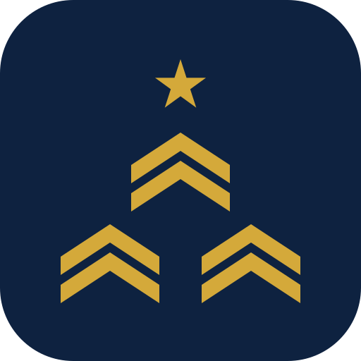

<p align="center">
  
</p>

<h1 align="center">caokit</h1>

<p align="center">
  <b>A small, local "company" of coding agents, run from one command line.</b>
</p>

<p align="center">
  <a href="https://github.com/ajzpiv97/cao-kit/actions/workflows/ci.yml"></a>
  <a href="https://github.com/ajzpiv97/cao-kit/tags"></a>
  <a href="LICENSE"></a>
  <a href="pyproject.toml"></a>
  
  <a href="https://github.com/awslabs/cli-agent-orchestrator"></a>
</p>

You talk to **one** commanding agent, the *General* (Claude Code by default). It drafts task files,
waits for your approval, then delegates to specialist coding-agent CLIs through
[CAO](https://github.com/awslabs/cli-agent-orchestrator) (`cli-agent-orchestrator`).

- **One agent to talk to.** The General takes the goal, writes the task file, dispatches an engineer,
  a scout and an inspector, and reports back. You approve plans and accept results.
- **Review comes from a different vendor.** Claude implements and Antigravity inspects Claude's code,
  re-running the task's validation commands itself. caokit refuses a roster where author and reviewer
  share a provider unless you opt in.
- **Your subscriptions, your machine.** It drives the CLIs you already pay for, holds no credentials,
  and no agent may merge, push or deploy. The human commits.

**Get started.** Needs macOS, `tmux`, `uv`, CAO 2.5.4, `claude` and `agy` ([full install](#install)):

```bash
uv tool install git+https://github.com/ajzpiv97/cao-kit
caokit doctor                  # checks CLIs, auth, CAO version and the server
caokit company create          # pick a tool and model per role
caokit install                 # install the profiles into CAO
caokit init /path/to/repo      # scaffold .company/ in your project
caokit server                  # terminal A: leave running
caokit launch /path/to/repo    # terminal B: talk to the General
```

The kit is generic: it assumes no particular project, language or stack. A project brings its
own validation commands (test/CI command) and its own rules.

- **Platform:** macOS (Apple Silicon tested), tmux backend.
- **CAO:** exactly **2.5.4**, installed with `uv tool`.
- **Status:** validated end to end with a Claude + Antigravity roster (see [Validation](#validation)).

**Contents:** [Install](#install) · [Quick start](#quick-start) · [Roles](#roles) ·
[Task workflow](#task-workflow) · [Working with the General](#working-with-the-general) ·
[Commands](#commands) · [Configuration](#configuration) · [Worktrees](#worktrees-one-per-task) ·
[Safety model](#safety-model) · [Validation](#validation) · [Developing caokit](#developing-caokit)

---

## Install

You need `git`, `tmux`, `uv`, `python3` (3.11+), CAO (`cao`, `cao-server`, `cao-mcp-server`),
`claude` and `agy`.

```bash
brew install tmux uv
uv tool install 'cli-agent-orchestrator==2.5.4'
curl -fsSL https://claude.ai/install.sh | bash
curl -fsSL https://antigravity.google/cli/install.sh | bash
uv tool install git+https://github.com/ajzpiv97/cao-kit   # or, from a checkout: uv tool install --from . caokit
caokit doctor                                             # CLIs, auth, CAO version, single CAO install, server, roster
```

- Log in to `claude` and `agy` **directly, outside CAO**, once (send one harmless prompt each), so
  no login screen appears inside an orchestrated terminal. `agy models` lists the exact model IDs.
- Change the CAO version only with `uv tool install --force 'cli-agent-orchestrator==X'`, never
  `uv tool upgrade` or `cao update`.
- After pulling new changes to a checkout, reinstall with `uv tool install --force --from . caokit`.

## Quick start

```bash
caokit company create --general claude:sonnet --engineer claude:opus \
    --scout antigravity:gemini-3.8-flash-medium --inspector antigravity:gemini-4-argon-high
caokit install                         # render and install the profiles into CAO
caokit init /path/to/repo              # scaffold .company/, ROSTER.md, merge .gitignore
caokit server                          # terminal A: start cao-server (leave running)
caokit launch /path/to/repo            # terminal B: start the General in this project
```

`caokit company create` with no role flags asks for a tool and model per role and offers the
recommended one.

For a hands-off smoke test instead of talking to the General, launch the scaffolded TASK-0001:

```bash
caokit launch /path/to/repo --headless --auto-approve --prompt-file /path/to/repo/.company/prompts/first-run.md
caokit status /path/to/repo           # watch the workers
```

Expect artifacts under `.company/` (`artifacts/`, `research/`, `reviews/`, `decisions/`) and no
application-source changes.

## Roles

| Role | Default tool | Job | Tool limits |
|---|---|---|---|
| `general` | Claude Code, `permissionMode: auto` | Single entry point: task intake, dispatch, acceptance procedure, synthesis | Native: no Bash, Agent/Task, Monitor, web. Read, list and write plus `cao-mcp-server` |
| `engineer` | Claude Code | Implements; runs **only** the task's authorised validation commands | Web blocked. `execute_bash` also unlocks Claude's Agent/Task tools, so "no subagents" is instruction-only |
| `scout` | Antigravity (`gemini-3.8-flash-medium`) | Research; does not build | Advisory only |
| `inspector` | Antigravity (`gemini-4-argon-high`) | Independent review; re-runs the authorised commands | Advisory only |

Why this split: **Claude implements, Antigravity inspects Claude's code.** Claude's tool limits are
enforced natively by CAO. Antigravity's are **advisory**: CAO launches it with
`--dangerously-skip-permissions`, so review must come from a different tool and model vendor than
the author.

Any role can be bound to any active tool (`caokit company create`). A soft-enforcement tool as
`engineer` or `general` needs an explicit opt-in (see [Policy](#policy)) because nothing then stops
it writing anywhere. Codex is parked (see [Parked: Codex](#parked-codex)).

Keep `fs_write` in the General's profile. CAO's validator warns that it is "not recognised", but
that is a gap in its own vocabulary check, and removing it would block the General's `.company/`
writes.

## Task workflow

1. **Intake.** You state the goal. The General writes `.company/tasks/TASK-NNNN-<slug>.md` from the
   template, then takes one of two paths:
   - **Fast path**, for a clear task that needs at most two agents and meets no plan-path trigger:
     the General records `APPROVED` under the pre-authorised rule and dispatches without stopping.
     You review the output afterwards.
   - **Plan path**, for anything else: `State: PROPOSED`, a Team plan with a per-agent cost
     estimate, draft acceptance checks marked "human must confirm", then the General **stops** for
     your approval. Triggers are auth or secrets, data deletion or migration, new dependencies,
     anything external, ambiguity, or more than two agents. In Claude Code's plan mode approval is
     always forced.
2. **Approval.** Only your explicit approval moves a plan-path task to `APPROVED`, logged in
   `DECISIONS.md`. You own the acceptance checks and the allowed-path review.
3. **Clarification.** Workers ask the General with `send_message`; the General answers from the task
   file and repository if it can, and otherwise asks you. It does not guess.
4. **Authorised validation commands.** The engineer and inspector run exactly the commands the task
   lists and nothing else (no `rm`/cleanup, installs, network, or state-changing git). Both write a
   **Commands run** section with real output. The inspector re-runs the commands itself.
5. **Acceptance procedure.** The General diffs every reported command against the allowlist and flags
   extras as a **contract breach**. It never accepts silently.
6. **Accept.** Only your "accept" moves a task to `ACCEPTED`. Then run `caokit tasks archive`.

Task files are the audit trail. Contracts live in `.company/contracts/` and are tracked by git; the
rest of `.company/` is git-ignored.

## Working with the General

- `caokit launch` **without** `--headless` attaches you to the General's Claude Code inside tmux.
  Workers are other tmux windows: `Ctrl-b w` lists them, `Ctrl-b d` detaches (the session keeps running).
- Web UI with live terminals: `http://127.0.0.1:9889/` (root path only). `cao tui` also exists.
- **Don't type into the General while it is mid-turn.** Worker reports queue and are delivered when it
  is idle. For check-ins use `caokit send "<msg>"`.
- Session names get a `cao-` prefix (project `proja` becomes `cao-proja`).
- Never use `cao launch --yolo` and never `allowedTools: ["*"]`: both bypass restrictions.

## Commands

Destructive commands (`uninstall`, `tasks prune`, `reset`) are dry runs unless you pass `--yes`.

**Setup**

| Command | Purpose |
|---|---|
| `caokit doctor` | Check CLIs, auth, CAO version, a single CAO install (uv tool only), the server and its web UI, and the roster |
| `caokit company create [--general\|--engineer\|--scout\|--inspector TOOL[:MODEL]] [--force]` | Write `caokit.toml` (role to tool and model), with every guardrail checked; `--force` overwrites an existing file |
| `caokit install [--project REPO]` | Render, validate, install and byte-verify profiles; `--replace-legacy` / `--remove-legacy` for old copies |
| `caokit uninstall [--project REPO] [--yes]` | Remove a roster's profiles from CAO. Leftover `agent-context` copies are moved to a backup, not deleted |
| `caokit init REPO [--name P] [--override ROLE=TOOL[:MODEL]] [--force-project]` | Scaffold `.company/` in a git repo; `--name` namespaces its profiles; `--force-project` overwrites an existing project file |
| `caokit reset [--yes]` | Back up CAO's state, reinstall CAO 2.5.4 and the profiles |

**Running a session**

| Command | Purpose |
|---|---|
| `caokit server` | Run `cao-server` (tmux backend) in the foreground |
| `caokit launch [REPO]` | Start the project's General; `--prompt-file F`, `--headless`, `--auto-approve`, `--async` |
| `caokit status [REPO]` | Show sessions and workers |
| `caokit send MESSAGE [--repo REPO] [--timeout S]` | Message the General (waits up to 600 s by default) |
| `caokit stop [REPO]` | Shut the session down |

**Tasks and worktrees**

| Command | Purpose |
|---|---|
| `caokit tasks [list] [REPO]` | Open tasks and what blocks them (`--all` includes finished ones) |
| `caokit tasks archive [REPO] [--delete]` | Move `ACCEPTED`, `CANCELLED` and `FAILED` tasks to `.company/tasks/archive/`; `--delete` removes them instead |
| `caokit tasks policy [REPO] [--keep-archived-days N] [--worktrees on\|off]` | Set how long a project keeps archived tasks, and whether each task gets its own worktree |
| `caokit tasks prune [REPO] [--days N] [--yes]` | Delete archived tasks older than the policy |
| `caokit tasks schedule [REPO] [--install\|--remove] [--at HH:MM]` | Print, add or remove the daily cron entry that archives and prunes |
| `caokit worktrees [REPO]` | List the `cao/*` task branches and checkouts, with unmerged commits |

## Configuration

Config lives in `~/.config/caokit/caokit.toml` (`$CAOKIT_HOME` or `--config` to override). Roles are
tool-agnostic; concrete CAO profiles are named `<role>-<tool>` (CAO allows only `[A-Za-z0-9_-]`).

### Per-project setups

CAO's profile store is machine-global (profiles are not looked up in a project directory), so two
projects sharing `engineer-claude` would overwrite each other's model. Give a project its own
namespaced profiles:

```bash
caokit init ~/proj-a --name proja                          # same roster as the user-level config
caokit init ~/proj-b --name projb --override engineer=:sonnet --override scout=claude:haiku
caokit install --project ~/proj-a                          # installs proja_general-claude, proja_engineer-claude, ...
caokit install --project ~/proj-b
caokit launch ~/proj-a                                     # session cao-proja
```

- Two layers: the user-level `caokit.toml`, then the project's `.company/caokit.toml` (git-ignored) with a
  `[project] name`, optional `[policy]`, `[tasks]`, and per-role `tool`/`model` overrides.
- Override forms: `role=tool`, `role=tool:model`, `role=:model` (keep the tool). Changing a role's tool
  without a model drops the user-level model (a model ID from one tool means nothing to another).
- Names are `<project>_<role>-<tool>`; the project is 1-24 lowercase letters, digits or `-`.
- All guardrails (cross-provider inspection, soft-tool opt-ins, model validation) re-run on the merged config.
- Without `--name`, `init` uses shared `<role>-<tool>` profiles, and the session is named after the directory.
- Each project is its own CAO session; one `cao-server` serves them all.
- Remove a project's profiles with `caokit uninstall --project ~/proj-a --yes` (it touches only that project's names).

### Policy

| Setting | Where | Effect |
|---|---|---|
| `allow_soft_engineer` | `[policy]` / `--allow-soft-engineer` | Lets a soft-enforcement tool (Antigravity) be the engineer |
| `allow_soft_general` | `[policy]` / `--allow-soft-general` | Lets a soft-enforcement tool be the General. CAO cannot deny its tools, so it could write anywhere and run commands. Prompt rules are all that hold it back |
| `allow_single_provider` | `[policy]` / `--allow-single-provider` | Downgrades the cross-provider inspection rule to a warning |
| `keep_archived_days` | project `[tasks]` | `tasks prune` deletes archived tasks older than this; unset keeps them forever |

### Keeping and pruning finished tasks

`caokit tasks archive` moves finished tasks out of the active folder and stamps the archive date.
Archived tasks are kept until the project's policy says otherwise:

```bash
caokit tasks policy ~/proj-a --keep-archived-days 90     # per project, stored in .company/caokit.toml
caokit tasks prune ~/proj-a                              # dry run: lists archived tasks older than 90 days
caokit tasks prune ~/proj-a --yes                        # deletes them
caokit tasks schedule ~/proj-a                           # prints the daily cron line
caokit tasks schedule ~/proj-a --install --at 03:17      # adds it to your crontab (only its own line)
```

Scheduling uses cron. `--install` refuses until a retention policy exists, replaces only the line
for that project, and `--remove` takes it out again. cron runs with a minimal environment, so the line
uses the absolute path to `caokit`. On macOS cron may need Full Disk Access to read your project folder.

## Worktrees: one per task

```bash
caokit tasks policy /path/to/repo --worktrees on   # needs a git repo root with a commit
caokit install                                     # reinstall profiles so the roles carry the rules
caokit worktrees /path/to/repo                     # list the task branches CAO left behind
```

With it on, the General dispatches each source-changing engineer through CAO's `use_worktree`: a private checkout at
`<repo>/.cao/worktrees/<terminal-id>` on branch `cao/<terminal-id>`, cut from HEAD. What to know:

- The engineer **commits on its own branch** (the only git write any worker may do, and only there). CAO deletes the
  checkout, with anything uncommitted, when the terminal is deleted; a committed branch survives.
- The General keeps the engineer's terminal until the task is accepted or cancelled, and sends rework to the same
  terminal, so one task is one worktree.
- The inspector reviews and re-runs the validation commands inside that checkout (`cd <worktree> && ...`).
- **You merge**: `git merge cao/<id>`, then `git branch -d cao/<id>`. caokit never merges or deletes branches.
- A new worktree starts from the last commit, so uncommitted changes in your main checkout are not in it.
- `.company/` is git-ignored, so agents read and write it at the project root, not in the checkout.
- **Git-ignored files are not in the checkout** (`node_modules`, `.venv`, `.env`, build caches), and CAO deletes them
  with it. Have the task's authorised commands start with your install step (`npm ci`, `pnpm install --frozen-lockfile`,
  `uv sync`); pnpm and uv share a global store, so that is cheap. Do not symlink the main `node_modules` in: parallel
  engineers would write into one shared tree. CAO has no setup hook, so caokit does not run the install for you yet.

## Safety model

- Claude roles: CAO deny-lists (native) plus `permissionMode: auto`.
- Antigravity: restrictions are **advisory**; treat its profile as guidance, not a boundary.
- No path-level enforcement: any agent with write access can write anywhere in the repo. Turn on
  [worktrees](#worktrees-one-per-task) so each writing task gets its own git worktree, and inspect
  `git diff` afterwards.
- No role may deploy, merge, push, contact third parties, use production credentials, change billing,
  or run destructive git. The human commits.
- Human approval is required for plan-path tasks, acceptance, merges, pushes, deployments, secrets,
  dependency changes and destructive actions.
- The kit holds no credentials by design.

## Validation

Last run on the `caokit` path: PASS with 13 checks passing and 1 manual (read the synthesis). About
122k fresh Claude tokens (input, output and cache writes), plus about 1.0M cache reads. Antigravity
leaves no token data, so its share is not counted.

The proof harness is `scripts/95-validate-e2e.sh`. It builds a throwaway repo (`taskly` sample app)
under `validation/`, runs `caokit init --name e2e` and `caokit install --project`, launches TASK-0001
with `caokit launch`, polls the CAO API, collects evidence and writes `evidence/ACCEPTANCE.md` with a
PASS/FAIL verdict and `evidence/token-usage.md`. Knobs:
`TIMEOUT_MIN=60 POLL_SEC=15 AUTO_NUDGE=1 STALL_MIN=10 KEEP_SESSION=0 FORCE_REPLACE=0 SKIP_AGY_MODELS=0`.
It needs Python 3.11+. `validation/` is local run evidence and is not committed.

## Developing caokit

```bash
export PYTHONPATH=src
uvx ruff check src tests && uvx ruff format --check src tests   # lint + format (Google docstrings enforced)
uvx mypy                                                          # strict types for src, lenient for tests
python3 -B -m unittest discover -s tests -t .                    # unit tests (a real-cao test runs if `cao` is installed)
```

CI (`.github/workflows/ci.yml`) runs the same four checks on macOS with Python 3.11 and 3.13 for
every push to `main` and every pull request.

Ruff and mypy both target Python 3.11, the minimum (`requires-python = ">=3.11"`); caokit has no
runtime dependencies. `uv tool install` fetches a suitable interpreter, so the system Python does
not matter.

`scripts/95-validate-e2e.sh` (the harness above) and `scripts/token_usage.py` (Claude token use per
session) are development tools for this repo, not part of the installed CLI.

## Parked: Codex

Codex was removed after every CAO failure turned out to be Codex-specific (MCP approval denied,
inherited `xhigh` reasoning, config drift). Its adapter is kept as metadata only and cannot be
selected. If Codex returns, the `send_message` callback needs:

```yaml
codexConfig:
  mcp_servers.cao-mcp-server.tools.send_message.approval_mode: "approve"
```

and an explicit `model_reasoning_effort`. Codex 0.134+ reads `~/.codex/NAME.config.toml` files.
The old Codex profile files are in git history.

## More

[`TROUBLESHOOTING.md`](TROUBLESHOOTING.md), [`SOURCES.md`](SOURCES.md), [`CHANGELOG.md`](CHANGELOG.md).

## License

MIT, see [`LICENSE`](LICENSE).
